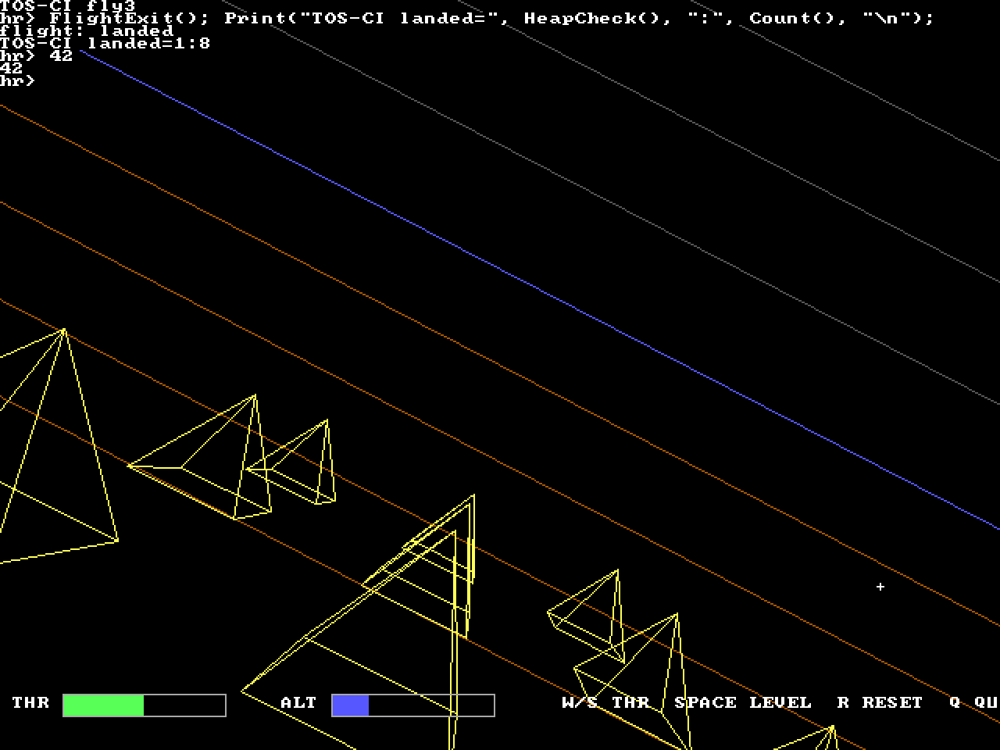

# HolyRust & TempleOS-RS

This repository contains **two things that build on each other**:

|  | What it is | Start here |
| :-- | :-- | :-- |
| **HolyRust** | A programming language with a self-contained x86-64 JIT — no LLVM, no external crates. The shell **is** the compiler, and ownership errors are caught *the instant they happen*, as diagnostics in a session that keeps running. | [Part 1](#part-1--holyrust) |
| **TempleOS-RS** | A 640×480, 16-colour operating system in the spirit of Terry A. Davis's TempleOS — built **with** HolyRust, and for almost everything above the hardware, **written in** it. | [Part 2](#part-2--templeos-rs) |

Two demonstrations carry the whole project. First, the ownership thesis — a
use-after-move is a *diagnostic*, not a crash, and the session survives it:

```console
hr> Str a = "who owns me?\n";
hr> Str b = a;                 // moves: `a` is invalidated AT RUNTIME
hr> Print(a);
runtime diagnostic: use of a moved value at repl:1:7
hr: statement aborted by a runtime diagnostic (session continues)
hr> Print(b);                  // the session survived — this is the whole point
who owns me?
```

Second, the self-hosting thesis. At the **in-kernel** prompt of the real OS:

```holyrust
Ed("/TOS/Files.HR");                                       // open the OS's own source
EdReplaceLine("Str OsName", "Str OsName() { return \"mine\"; }");
EdSave();                                                  // write it back
#include "/TOS/Files.HR"                                   // recompile, in this session
Print(OsName(), "\n");                                     // -> mine
```

No reboot, no crash, `HeapCheck()` = 1 throughout. `tools/kernel_ci.py` runs
exactly that sequence, in QEMU, on every CI run.

---

## Quick start

**Windows** (what this repository was developed and verified on). Open a
terminal in the project folder — this is a source snapshot, not a git checkout,
so there is nothing to clone:

```powershell
# 1. host compiler + language tests (110 tests, ~4 min including a full QEMU boot)
powershell -NoProfile -ExecutionPolicy Bypass -File tools\cargo.ps1 test --release

# 2. try the language
.\target\release\hr.exe demos\tour.hr          # guided tour of every language feature
.\target\release\hr.exe                        # interactive shell

# 3. build and boot the operating system (needs QEMU)
powershell -NoProfile -ExecutionPolicy Bypass -File kernel\build.ps1
& "C:\Program Files\qemu\qemu-system-x86_64.exe" -kernel kernel\kernel.bin -m 256M -smp 1 -serial stdio

# 4. the full scripted QEMU session, all phase gates, prints KERNEL-CI: PASS
python tools\kernel_ci.py
```

**Linux:** identical, with `cargo` instead of `tools/cargo.ps1`, `kernel/build.sh`
instead of `kernel/build.ps1`, and `python3`.

> **Use `tools/cargo.ps1`, not bare `cargo`, on Windows.** It clears future-dated
> build artefacts and forces a real rebuild when it detects them. This is not
> paranoia: this machine's clock jumps backwards, which made `cargo` report
> `Fresh hr-kernel` forever while three genuinely different `gfx.rs`
> implementations produced byte-identical kernels (see [D050](docs/DECISIONS.md)).

---

# Requirements

| Need | Why | Notes |
| :-- | :-- | :-- |
| **x86-64** CPU | The JIT emits x86-64 machine code | 32-bit and ARM hosts are not supported |
| **Rust (rustup, stable)** | The compiler is written in Rust | `rustup toolchain install stable` |
| **`x86_64-unknown-none` target** | Only for building the OS kernel | `rustup target add x86_64-unknown-none` |
| **QEMU** | Only for booting the OS | `qemu-system-x86_64`; on Windows the default install path is detected automatically |
| **Python 3** | Only for `tools/kernel_ci.py` and `tools/gen_font8x8.py` | Windows: `python`, not the Microsoft Store stub |
| ~2 GB free disk | Toolchain + build artefacts | |

**No C compiler is required on Windows.** The kernel is assembled and linked
entirely by tools that ship with rustc (`rust-lld`, rustc's integrated
assembler), so you do *not* need `as`, `ld`, `objcopy`, nasm, or Visual Studio's
C++ workload — rustup's bundled `rust-mingw` provides the linker. On **Linux**
the kernel uses the GNU toolchain path (`kernel/build.sh`), so `gcc`/binutils are
needed there.

`tools/setup_env.sh` (Linux) checks your machine and reports exactly what is
missing — it installs nothing and needs no root. `tools/env.sh` is sourced by the
shell scripts and configures nothing unless the toolchain really lives under
`/opt`. On Windows the equivalents are `tools/cargo.ps1` and `kernel/build.ps1`.

---

# Part 1 — HolyRust

## 1.1 The idea

Most languages check ownership before the program runs, or not at all. HolyRust
checks it **while it runs**, in a live session where code exists the moment you
type it. That inversion is the design thesis, argued in
[LANG_SPEC §1](docs/LANG_SPEC.md):

- **Liveness (TempleOS).** There is no `main()`. Top-level statements execute in
  order. A bare string statement auto-prints. Defining a function makes it
  callable on the next line. Redefining it hot-swaps the call target for
  everything that runs afterwards.
- **Safety (Rust).** `Str` and `class` are *Move* types. Assigning one transfers
  it and invalidates the source. Borrows obey one-mutable-XOR-many-immutable.
  Violations are traps — but traps are **diagnostics**, catchable with
  `try/catch`, and an uncaught one aborts only the current statement.

The whole language is defined in **[docs/LANG_SPEC.md](docs/LANG_SPEC.md)**. If a
feature is not in that document, it does not exist.

## 1.2 Using it

```powershell
.\target\release\hr.exe                       # interactive shell (REPL)
.\target\release\hr.exe demos\tour.hr         # compile and run a file
```

### CLI reference

| Command | What it does |
| :-- | :-- |
| `hr` | Interactive shell. Prompts `hr>`, continues on `...` while braces are unbalanced, `#quit`/`Ctrl-D` to exit. |
| `hr FILE.hr` | Compile and run a file. Diagnostics are positioned; exit code is non-zero if anything failed or trapped. |
| `hr --dump-tokens FILE` | Print the token stream (`line:col offset..end TOKEN`). |
| `hr --dump-ast FILE` | Print the AST in the stable snapshot format. |
| `hr --dump-code FILE` | Compile and write the machine-code blob to a temp file, printing its base address and entry offset. |
| `hr --bench` | Latency harness → the numbers in [docs/BENCHMARKS.md](docs/BENCHMARKS.md). |

### REPL commands

| Command | Effect |
| :-- | :-- |
| `#help` | Print the help text |
| `#history` | Show this session's inputs |
| `#reset` | Start a fresh session (new globals, functions, classes) |
| `#quit` / `#exit` / `Ctrl-D` | Leave |

Every session appends to **`session.log`** in the working directory: session
headers, each input line, rendered diagnostics, aborts, and per-statement
latency (`[stmt N] X.XXXms`) — the Phase 5 p95 gate reads that log. Guest output
and value echoes go to **stdout**; the banner, prompts and diagnostics go to
**stderr** (D036), so `hr file.hr > out.txt` captures only your program's output.

## 1.3 A guided tour

`hr demos/tour.hr` — the output below is the real thing, not an illustration:

```console
$ hr demos/tour.hr
Hello from a bare string literal.
count=42 ratio=1.5
Digits()=12  Digits(,6)=16  Digits(9)=92
Sum(1,2,3,4)=10
zero
small
even-ish
other
acc=10
5!=120
point 3,4
caught: use of a moved value (moved or never initialized)
b still works: owned
via shared borrow: 5
caught: borrow conflict (rule: one mutable XOR many immutable)
after unsafe write: 9
code generated at compile time -> Six()=6
```

Each section of [demos/tour.hr](demos/tour.hr) is annotated with the LANG_SPEC
section it demonstrates. The highlights:

**No `main()`, and bare strings print** (§4). Top-level statements are the
program.

**Default arguments at any position** (§5). Omission uses an empty slot, and only
parameters that *have* a default may be omitted:

```holyrust
I64 Digits(I64 a = 1, I64 b = 2) { return a * 10 + b; }
Digits()      // 12
Digits(,6)    // 16  <- a takes its default
Digits(9)     // 92  <- b takes its default
```

**Variadics** (§5) expose implicit `argc`/`argv`:

```holyrust
I64 Sum(...) {
  I64 total = 0;
  for (I64 i = 0; i < argc; i++) { total += argv[i]; }
  return total;
}
```

**`switch`** (§6) has *no fallthrough* (HolyC semantics) and accepts comma lists
and inclusive ranges:

```holyrust
switch (v) {
  case 0:        Print("zero\n");
  case 1...5:    Print("small\n");
  case 6, 8, 10: Print("even-ish\n");
  default:       Print("other\n");
}
```

**Runtime ownership** (§7). Scalars are Copy; `Str` and `class` are Move:

```holyrust
Str a = "owned\n";
Str b = a;                    // `a` is invalidated NOW
try { Print(a); } catch { Print("caught: ", catch_msg, "\n"); }
Print("b still works: ", b);  // the session survived
```

The runtime reports trap codes you can branch on: `-10` use-after-move, `-11`
borrow conflict, `-12` write through a shared borrow, `-13` invalid pointer.

**Borrows** (§7/§8) enforce one-mutable-XOR-many-immutable at borrow creation
*and* at writes. `unsafe { }` (§10) is the documented escape hatch:

```holyrust
I64 n = 5;
I64 *shared = &n;             // shared borrow
I64 *excl = &mut n;           // traps: borrow conflict while `shared` is live
unsafe { *shared = 9; }       // no checks
```

**Strictness is adjustable** (§8). `#![ownership(strict|loose|off)]` as the first
line of a file, or as a statement inside a block, dials move-tracking and borrow
checks down for that unit. Default is `strict`.

**`#exe { }`** (§12) runs a block at *compile* time and splices what it prints
back into the program as source text — code that writes code:

```holyrust
#exe {
  "I64 Six() { return 6; }\n";
}
Print(Six(), "\n");           // 6
```

**`#include "path"`** splices another file's source into the unit being compiled.
The path is looked up in the session's in-memory filesystem *first* (which is what
lets the OS include its own source), then on disk. Nesting is capped at 8, and a
missing file is a positioned `C094` error, never a silent no-op.

## 1.4 How the compiler works

```
   source text
        │
        ▼
  hr_lexer      tokens (positions on every token; never panics on garbage)
        │
        ▼
  hr_parser     AST, error-recovering (one bad line does not hide the next)
        │
        ▼
  pipeline      #include splice → #exe compile-time execution → re-parse
        │
        ▼
  hr_check      types, ownership *rules*, builtin signatures → typed IR
        │
        ▼
  hr_codegen    own x86-64 emitter (no LLVM) → code blob + relocations
        │
        ▼
  hr_runtime    mmap/VirtualAlloc → patch → mprotect RX → call
                (runtime context lives in r15; arena; trap handling; shadow
                 ownership state; the filesystem; the editor buffer)
        │
        ▼
  hr_shell      the REPL: one Session backs the whole session, so globals,
                functions and classes persist across lines
```

Things worth knowing about the implementation:

- **Zero external crates.** `Cargo.toml` has no dependencies; the runtime calls
  `mmap`/`mprotect` on Linux and `VirtualAlloc`/`VirtualProtect` on Windows
  through hand-written declarations. That is what makes the *same* compiler
  embeddable in a kernel with `no_std + alloc`.
- **The JIT contract is the calling convention, not the OS.** Every runtime
  function the generated code calls is declared `extern "sysv64"`, so the
  emitted code is identical on Linux and Windows (on Linux `extern "sysv64"` *is*
  `extern "C"`). See [D043](docs/DECISIONS.md).
- **Ownership is enforced at runtime**, so the "compiler" that catches a
  use-after-move is the *runtime*, working from shadow state keyed on places and
  blocks. That is why the diagnostic can carry a live position and why the
  session can continue afterwards.
- **Hot-patching** (§5) compiles a new body and swaps the existing function's
  indirection cell, so already-running code starts calling the new version. The
  kernel demo does this to a "kernel" function while its event loop runs.
- **Adding a builtin** means touching four places: `BuiltinId` in
  `src/hr_check` (signature + name), its `OFF_*` offset in `src/hr_runtime`
  (`FnTable` + a `rt_*` implementation), the mapping in `src/hr_codegen`, and —
  for the kernel — a hook installed at boot. Part 2's builtins all follow that
  path.

## 1.5 The demos

| Demo | Shows |
| :-- | :-- |
| `demos/tour.hr` | Every language feature, section by section |
| `demos/hello.hr` | The minimum: printing and arithmetic |
| `demos/fizzbuzz.hr` | Loops and conditionals |
| `demos/ownership_demo.hr` | Move/borrow traps caught live by `try/catch` |
| `demos/exe_block.hr` | `#exe {}` generating a function at compile time |
| `demos/kernel_sim.hr` | Live hot-patching of a running "kernel" event loop |

---

# Part 2 — TempleOS-RS

## 2.1 The idea

**This OS is written in itself. Edit any file, re-include it, the OS changes.**

A single-tasking, 640×480×16 operating system. Rust owns exactly what must touch
hardware; **everything above that is guest code in `/TOS/*.HR`, compiled by the
in-kernel JIT at boot**, and editable while the machine runs.

| Layer | Where it lives | Language |
| :-- | :-- | :-- |
| Boot, long mode, port I/O, bump allocator | `kernel/boot.S`, `kernel/src/lib.rs` | asm + Rust |
| Hardware services: VGA mode 12h, PS/2 keyboard and mouse, PIT clock, PC speaker, entropy | `kernel/src/{gfx,kbd,mouse,timer,sound,rng}.rs` | Rust |
| Compiler, JIT, ownership runtime, hot-patch engine | `src/hr_*` | Rust (HolyRust v1) |
| **Filesystem commands, shell, drawing, tunes, oracle, editor, flight simulator** | `tos/*.HR` — loaded at boot | **HolyRust** |



## 2.2 Booting it

```powershell
powershell -NoProfile -ExecutionPolicy Bypass -File kernel\build.ps1
& "C:\Program Files\qemu\qemu-system-x86_64.exe" `
    -kernel kernel\kernel.bin -m 256M -smp 1 -serial stdio
```

A QEMU window opens showing the real VGA output. **Click into the window** to
give it keyboard and mouse focus (`Ctrl+Alt+G` releases the mouse). `-serial
stdio` mirrors the console to your terminal, which is handy because the boot
transcript there is what every diagnostic goes to.

Expected boot transcript (this is also how a failure is diagnosed — each of the
OS's own source files is named as it is compiled). Real output, not an
illustration:

```console
S1:32bit-entry
S1.5:paging-on
S2:64bit-longmode
S2.1:pre-bss-zero
S2.2:pre-kmain
S3:rust-kmain
S4:hooks-set
TOS: compiling /TOS/Files.HR
TOS: compiling /TOS/Graphics.HR
TOS: compiling /TOS/Sound.HR
TOS: compiling /TOS/Oracle.HR
TOS: compiling /TOS/Editor.HR
TOS: compiling /TOS/Flight.HR
TOS: compiling /TOS/Shell.HR
TOS: /TOS loaded - this OS is written in itself
HolyRust kernel shell — the compiler runs IN the kernel
heap integrity: 1
[echo-v1] 104
[echo-v1] 105
pumped 2 boot keys
mouse: 1  clock: 290ms  date: 20261015
kernel: ready — type HolyRust (serial or PS/2 keyboard)
0
hr>
```

Boot takes **1.8–4.7 s** under pure emulation (TCG) against the project's 5 s
gate; most of it is the OS compiling its own seven source files with its own JIT.
`#quit` at the prompt halts the machine.

Prefer it headless? That is exactly what the CI does — `-display none` plus
monitor-driven keyboard and mouse, so no window is needed:

```powershell
python tools\kernel_ci.py        # full scripted session; prints KERNEL-CI: PASS
```

## 2.3 Using the shell

Anything you type is compiled and executed as you type it. A line that is exactly
one bare word is treated as a *command word* and dispatched by
`/TOS/Shell.HR`; everything else is HolyRust.

| Command | What it does |
| :-- | :-- |
| `help` | List commands and builtins |
| `ls` | Every file in the filesystem |
| `files` | The OS's own source (`Dir("/TOS/*.HR")`) |
| `docs` | The OS's documentation |
| `demo` | Graphics self-test: switch to mode 12h and draw |
| `beep` | Play a scale on the PC speaker |
| `oracle` | A randomly chosen verse |
| `flight` | Fly over the wireframe pyramids |
| `edshow` | Print the editor's buffer with line numbers |
| `edsave` | Write the editor's buffer back |

Anything with arguments is called as a HolyRust function:

```holyrust
Dir("/TOS/*.HR");                  // entries matching a glob (one '*')
Cat("/TOS/Doc/TempleOS-RS.txt");   // print a file
FWrite("/Tmp/notes.txt", "hello"); // create or overwrite
FRead("/Tmp/notes.txt");           // read it back
FDel("/Tmp/notes.txt");            // delete it
Count();                           // how many entries
```

Because filesystem commands are just guest code, you can rewrite them live:

```holyrust
I64 Count() { return 4242; }       // hot-patch the OS's own function
Count();                           // 4242
```

## 2.4 Flying

`flight` puts you over a field of wireframe pyramids, in the spirit of
TempleOS's *AfterEgypt*. It is [tos/Flight.HR](tos/Flight.HR) — guest code,
compiled at boot, using only the graphics builtins.

| Control | Effect |
| :-- | :-- |
| Mouse X | bank (roll) |
| Mouse Y | pitch |
| `w` / `s` | throttle up / down |
| `space` | level the wings |
| `r` | reset the aircraft |
| `q` | land, back to the shell |

The horizon tilts as you bank and drops as you pitch — that is the entire
illusion, and it is what the CI asserts on, in pixels. Fly it a frame at a time
if you prefer:

```holyrust
FlightInit();      // enter graphics mode and reset
FlightStep();      // one frame: read input, integrate, render
FlightRun(200);    // many frames
FlightExit();      // land
```

The simulator is **frame-driven on purpose**: a cooperative OS with no scheduler
should not own the machine forever, and one frame is the unit a script can
observe. Its trigonometry is real floating point (`F64`), implemented in guest
code because there is no libm in the kernel.

## 2.5 The `/TOS` modules

| File | What it provides |
| :-- | :-- |
| [`tos/Files.HR`](tos/Files.HR) | Filesystem commands and glob matching: `Dir`, `Cat`, `FWrite`, `FRead`, `FDel`, `Exists`, `Count`, `Size`, `OsName`, plus `GlobMatch`/`MatchCurrent`/`StartsWith`/`EndsWith`/`StrFind` on four storage builtins |
| [`tos/Graphics.HR`](tos/Graphics.HR) | The shape vocabulary: `Line`, `Rect`, `FillRect`, `Circle`, `FillCircle`, `TextOut`, `TextCentered`, `GfxDemo` |
| [`tos/Sound.HR`](tos/Sound.HR) | Note constants, `Music(...)`, `Rest`, `Scale`, `Fanfare`, `Chirp` |
| [`tos/Oracle.HR`](tos/Oracle.HR) | The God-speaker: eight verses, `Oracle()`, `OracleN(k)` |
| [`tos/Editor.HR`](tos/Editor.HR) | `Ed`, `EdShow`, `EdReplaceLine`, `EdSaveAndReport` over seven editing primitives |
| [`tos/Flight.HR`](tos/Flight.HR) | The flight simulator |
| [`tos/Shell.HR`](tos/Shell.HR) | Prompt, command dispatch (`Sh`), `Help`, boot script |
| [`tos/Doc/TempleOS-RS.txt`](tos/Doc/TempleOS-RS.txt) | The OS's own documentation — readable *inside* the OS via `docs` |

## 2.6 How the OS works

**Boot.** `boot.S` sets up page tables (1 GiB identity-mapped), enables PAE +
SSE + long mode, and jumps to Rust. `kmain` installs a bump allocator over
32–224 MiB, initialises VGA/serial, installs the **hooks** below, starts the PIT,
then hands control to the shell — which seeds `/TOS` into the filesystem,
**compiles its own seven source files with the in-kernel JIT**, runs a small boot
script, and drops into the prompt.

**The hook pattern.** The language runtime is `no_std` and knows nothing about
hardware. Each kernel service is published as a table of function pointers that
the kernel installs at boot; guest builtins call through them, and a build
without the hardware honestly reports zero instead of pretending:

| Hooks | Installed by | Guest builtins |
| :-- | :-- | :-- |
| `GfxHooks` | `kernel/src/gfx.rs` | `GfxInit`, `GfxClear`, `Plot`, `GfxChar` |
| `TimeHooks` | `kernel/src/timer.rs` | `Sleep`, `Time`, `Date` |
| `MouseHooks` | `kernel/src/mouse.rs` | `MouseInit`, `MouseX`, `MouseY` |
| `SoundHooks` | `kernel/src/sound.rs` | `Beep`, `SoundOff` |
| `RngHooks` | `kernel/src/rng.rs` | `Random` |
| `KeyHooks` | `kernel/src/lib.rs` (via `kbd::poll`) | `SimKey` (`SimPush` is the simulated queue) |

**Everything else is storage and strings**, because that is the minimum a
self-hosting system needs: `FsWrite`, `FsRead`, `FsList`, `FsDelete`, `StrLen`,
`StrEq`, plus `HeapCheck` (memory integrity) and `HotPatch` (live redefinition).
That is the entire builtin surface — 30 builtins in total.

**Graphics** are VGA mode 12h (640×480×16, planar). The framebuffer is written
through **write mode 2** with a bit mask, and the byte is read before each masked
write so the four plane latches load correctly — two details that cost real
debugging and are recorded in [DECISIONS.md](docs/DECISIONS.md). The 16-colour
DAC is programmed explicitly, and the 8×8 font is compiled into the kernel.

**The self-hosting loop** is the point of the whole exercise:

```
edit /TOS/Files.HR  →  EdSave()  →  #include "/TOS/Files.HR"  →  new behaviour
```

No reboot, no separate toolchain, no build step. The filesystem the OS edits is
the same one it booted from, and `HeapCheck()` proves memory integrity after.

## 2.7 Tests and gates

Two layers, and both must pass.

**Host suite** — `tools/cargo.ps1 test --release` → **110 tests** across 22
targets, zero warnings. It includes golden lexer/parser suites, fuzzers, AST
snapshots, execution tests with exact-output assertions, a 30-plus-case ownership
matrix (zero segfaults, 100 % use-after-move catch), a scripted REPL session with
a latency gate, a lint test enforcing *no `unwrap`/panic on any user-input path*,
and the `/TOS` integration tests — which boot the **same `.HR` sources the kernel
boots** in a host session with recording hooks.

**Kernel CI** — `python tools/kernel_ci.py` boots the real kernel in QEMU, drives
it over a serial socket and the QEMU monitor, and asserts on the actual pixels of
screendumps. It prints `KERNEL-CI: PASS` and covers every phase gate:

| Gate | What is asserted |
| :-- | :-- |
| Boot | Kernel reaches the shell in < 5 s |
| **G1** Filesystem | `Dir("/TOS/*.HR")` lists all seven sources; full create/read/list/delete lifecycle in-OS; `/TOS/Files.HR` hot-patched live with the filesystem and heap still intact |
| **G2** Graphics | Mode 12h entered; exact pixels placed (white/red/green where asked, neighbours still black); shapes drawn from HolyRust; console overlay alive after the mode change |
| **G3** Input & timer | `Sleep(100)` returns; `Date()` reads the CMOS clock; the PS/2 mouse tracks the monitor and the cursor is found on the framebuffer |
| **G4** Sound & oracle | Tones programmed and logged with exact frequencies; multi-note tune; the oracle varies across draws and cannot index out of range |
| **G5** Self-hosting | The OS opens its own source, rewrites a line, saves, `#include`s it back, and the new code runs — filesystem and heap still healthy |
| **G7** Flight | Horizon level in level flight; banking tilts it (+72 px in the captured run); pitching moves it (−68 px); clean exit |
| Font | Glyphs are not mirrored — checked by *shape*, since a mirrored glyph has an identical pixel count |

**Continuous integration** — `.github/workflows/ci.yml` runs two jobs on every
push and pull request. The `host` job is the required gate: it builds and runs
the whole 110-test suite, where the kernel test reports an honest `KERNEL-CI:
SKIP` because the runner has no QEMU. The `kernel` job installs QEMU and boots
the real OS through every phase gate.

The `kernel` job is marked `continue-on-error`, deliberately. Its boot gate is
"< 5 s to the shell", and that number is host-dependent: the same kernel measured
1.8 s to 4.7 s across runs here and went past 5 s once when the machine was busy,
because a descheduled emulator simply takes longer. A shared runner is exactly
that situation, and a badge that goes red on emulator scheduling teaches people
to ignore it.

---

# Troubleshooting

| Symptom | Cause and fix |
| :-- | :-- |
| Edits have no effect; `cargo` says `Fresh` | The clock-jump staleness bug. Use `tools/cargo.ps1` (it clears future-dated artefacts) and confirm with `cargo -v` whether it says `Fresh` or `Compiling` |
| `python` opens the Microsoft Store | The Store stub, not Python. Install real Python or use `py` |
| `KERNEL-CI: FAIL — transcript missing 'halting (reset)'` | The QEMU serial socket was torn down before the guest's last write. The CI uses a chardev `logfile` for exactly this reason; don't remove it |
| Kernel dies silently right after `TOS: compiling <file>` | A fault with no IDT to report it. The transcript names the file; bisect the *language construct* rather than the file (see [D059](docs/DECISIONS.md) for how misleading a file bisect can be) |
| Boot exceeds 5 s | Under parallel load the emulator is descheduled. Re-run; the gate is asserted on every run rather than assumed |
| `Sleep(100)` measures far more than 100 ms | Not a bug: v1 has no interrupts, so the clock is *polled*, and a polled clock expresses host scheduling as overshoot. See [docs/BENCHMARKS.md](docs/BENCHMARKS.md) |
| QEMU window ignores the keyboard | Click into the window first; `Ctrl+Alt+G` releases the grabbed mouse |
| `qemu-system-x86_64` not found | Install QEMU. On Windows the CI also probes `C:\Program Files\qemu\` |

# Project layout

```
src/hr_lexer/       tokens, positions, fuzz-safe
src/hr_parser/      AST + error recovery + snapshot dumps
src/hr_check/       types, ownership rules, builtin signatures
src/hr_codegen/     x86-64 emitter (no LLVM) + fixups
src/hr_runtime/     Session, arena, traps, shadow ownership, filesystem,
                    editor buffer, and every rt_* builtin
src/hr_shell/       the REPL
src/pipeline.rs     compile_and_run, #include splice, #exe compile-time engine
kernel/boot.S       multiboot, page tables, long mode, CR0/CR4
kernel/src/         the OS: gfx, kbd, mouse, timer, sound, rng, serial, vga,
                    shell, font8x8, bump allocator
tos/                the OS's own source: *.HR + Doc/TempleOS-RS.txt
demos/              language demos, incl. tour.hr
tests/              host suite, incl. the /TOS integration tests
tools/              cargo.ps1, build helpers, kernel_ci.py, gen_font8x8.py
docs/               specs, progress log, decisions, benchmarks
```

# Documentation

| Document | What it gives you |
| :-- | :-- |
| [docs/LANG_SPEC.md](docs/LANG_SPEC.md) | **The language definition** (§1–§14). A feature not in here does not exist |
| [docs/SPEC_TOS.md](docs/SPEC_TOS.md) | The TempleOS-RS build specification this implements |
| [SPEC.md](SPEC.md) | HolyRust v1's original Single Source of Truth |
| [docs/PROGRESS.md](docs/PROGRESS.md) | Every phase's THINK → EXECUTE → TEST → REVIEW → DECIDE, including the failures |
| [docs/DECISIONS.md](docs/DECISIONS.md) | D001–D060: each architectural choice and its rationale |
| [docs/OPEN_QUESTIONS.md](docs/OPEN_QUESTIONS.md) | Spec ambiguities and the conservative reading taken |
| [docs/BENCHMARKS.md](docs/BENCHMARKS.md) | Latency numbers vs the gates, regenerated by `hr --bench` |
| [docs/FUTURE_IDEAS.md](docs/FUTURE_IDEAS.md) | Scope-creep quarantine: what was deliberately not built |
| [INSTALL.md](INSTALL.md) | Per-platform install notes |

# Limits and non-goals

Stated plainly, because a project that hides these is not trustworthy:

- **Single-tasking, no SMP, no networking, no UEFI, no multi-user.** These are
  frozen out of scope, not forgotten.
- **No interrupts.** The clock is a polled PIT counter, so `Sleep` is imprecise
  by construction (documented in D051 and measured in BENCHMARKS.md).
- **`Str` has no building primitives** — no `StrCat`, `StrSlice` or
  `StrFromI64` (F18). Values come from literals or `FsRead`. This is why
  `/TOS/Shell.HR` dispatches *argument-less* command words, and why the flight
  HUD draws bars instead of numbers.
- **`Str[i]` traps at `i == len`**, so always bound loops with `StrLen`.
- **A `Str` parameter is consumed when passed to a user function.** Never pass a
  `Str` variable to a user function more than once, and never use it afterwards.
  Use builtins (`StrLen`, `StrEq`) or hold the value in a global.
- **`Str *p` borrow parameters crash** with an access violation — a genuine v1
  defect with no fix in scope. Recorded as
  [Q12](docs/OPEN_QUESTIONS.md); the `/TOS` code avoids borrows.
- **Boot is 1.8–4.7 s**, above the project's 1 s aspiration: the OS JIT-compiles
  its own source at boot. That is the design, not slack, and it is stated rather
  than hidden.
- **The boot-time page tables identity-map 1 GiB** and code memory is RWX in v1
  (documented simplification; W^X hardening is F6).
